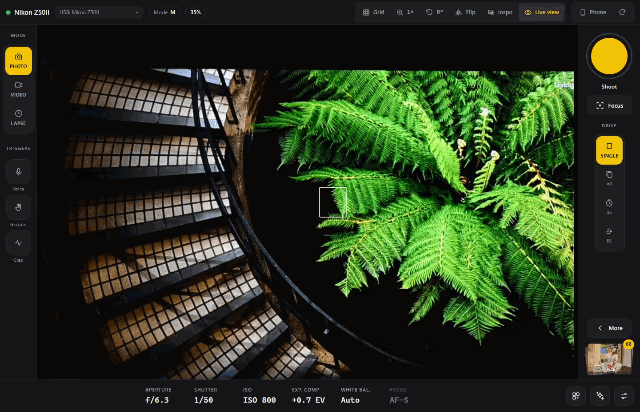
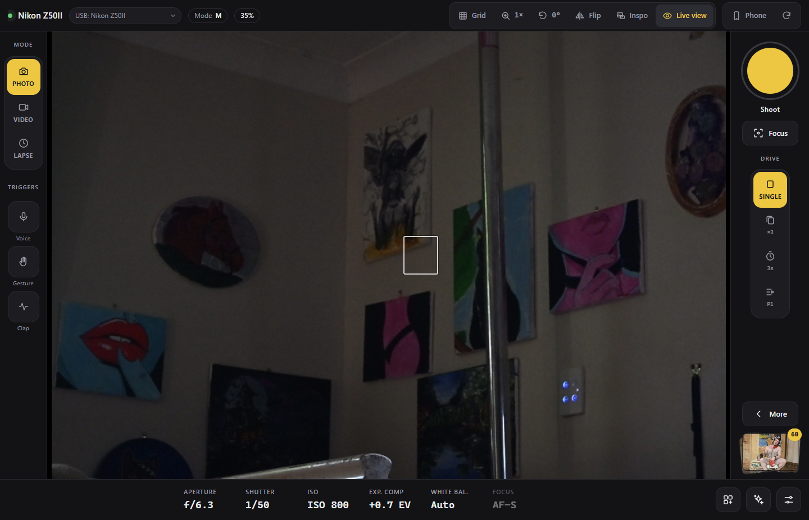
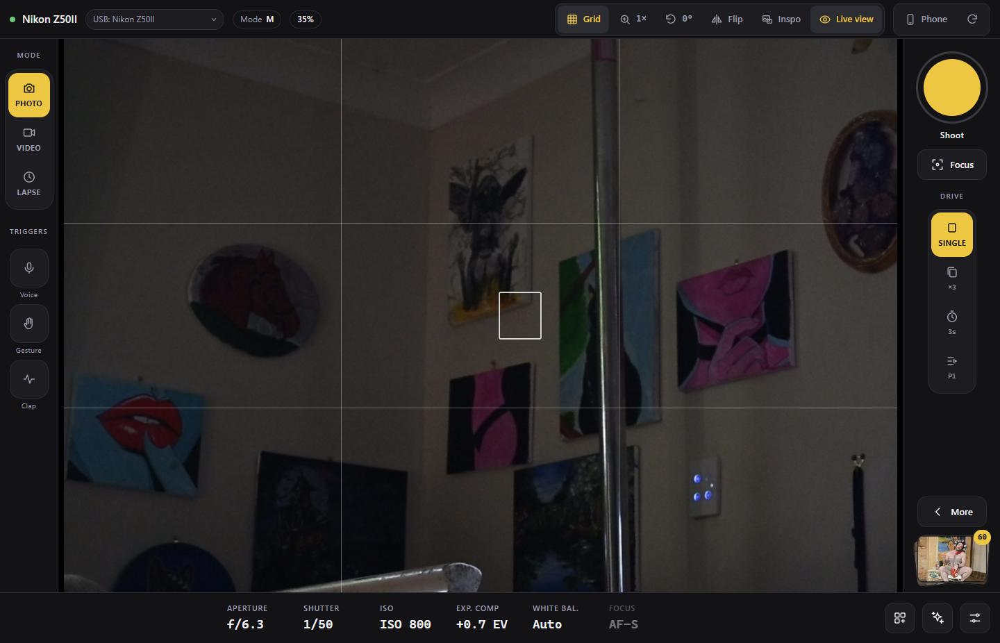
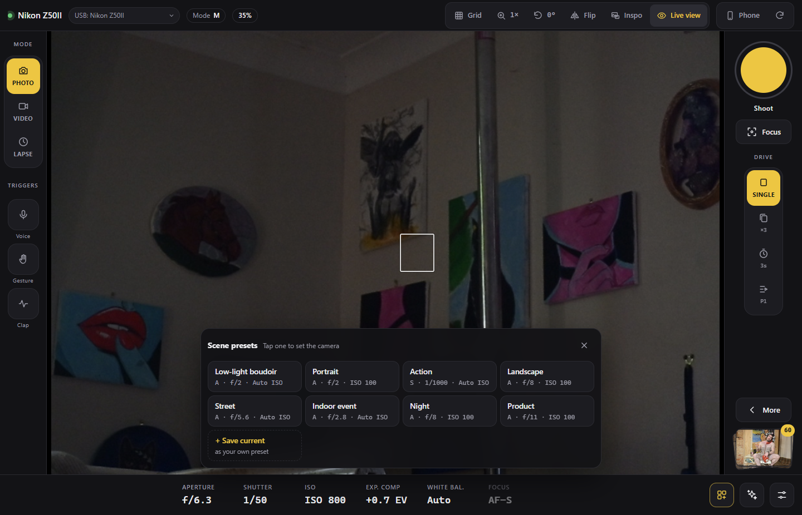
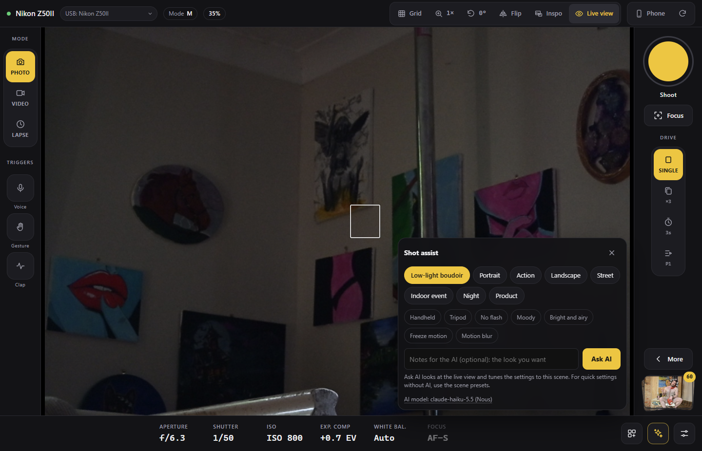
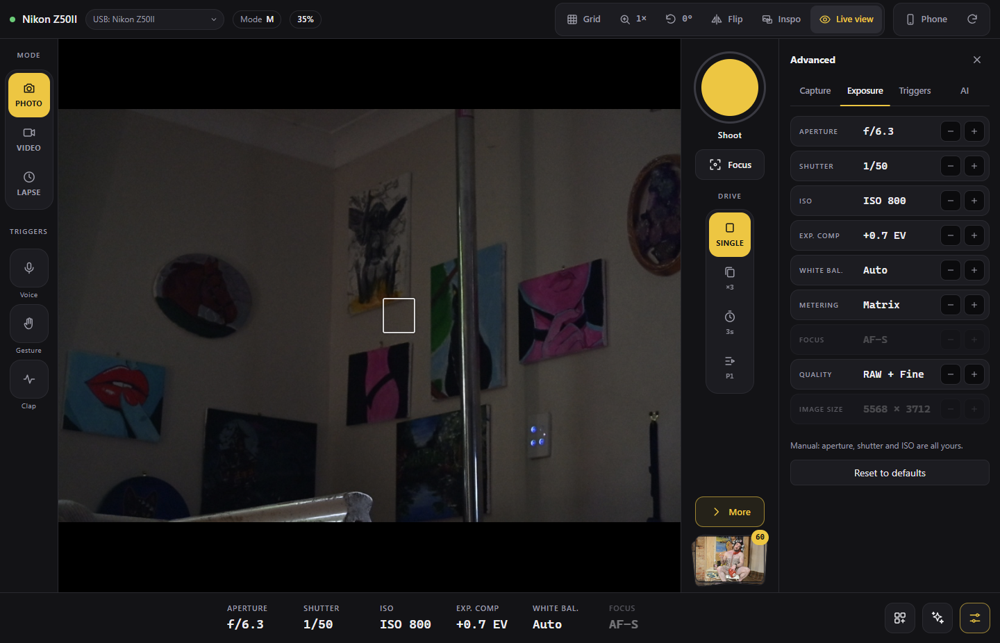
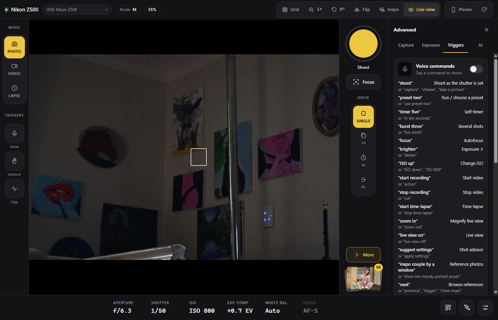

# Nikon Remote

[](https://github.com/terraseraph/nikon-remote/actions/workflows/release.yml)
[](https://github.com/terraseraph/nikon-remote/releases/latest)

**Download for Windows:** [Installer](https://github.com/terraseraph/nikon-remote/releases/latest/download/Nikon-Remote-Setup.exe) · [Portable .exe](https://github.com/terraseraph/nikon-remote/releases/latest/download/Nikon-Remote-Portable.exe) · [All releases](https://github.com/terraseraph/nikon-remote/releases)

A USB remote for your camera that runs on your own Windows PC: live view, full exposure control, an AI shot assistant, reference-photo posing guides, and hands-free triggers by voice, gesture or clap. Use it in its own **desktop window**, in **Chrome or Edge**, or from your **phone** over Wi-Fi or the internet.

Built and tested on a **Nikon Z50II**, with experimental support for **Canon EOS**, **Sony Alpha** and other PTP cameras (see [Supported cameras](#supported-cameras)). No camera drivers, SDKs or vendor software needed: it talks to the camera over the PTP driver that Windows already has. A **webcam** or other USB video camera works too (see [Webcams](#webcams)).



<sub>[Full-quality video](docs/media/walkthrough.mp4)</sub>

| | |
| --- | --- |
|  |  |
| Live view with the camera's focus box | Rule-of-thirds grid |
|  |  |
| One-tap scene presets | Shot assist |
|  |  |
| Exposure settings | Voice, gesture and clap triggers |

## Features

### Camera control
- **Live view** at 1024px with the camera's focus box drawn on top
- **Tap to focus:** tap anywhere on the live view to move the AF point there and focus
- **Zoom** 2× or 3× around the focus point to check framing and sharpness
- **Rotate and flip** the preview for odd mounting angles or mirrored selfie framing
- **Exposure controls:** aperture, shutter, ISO, exposure compensation, white balance, metering, focus mode, image quality and size. What's writable follows the mode dial: everything in **M**, partial in P/A/S.
- **Video recording:** start and stop by button, key, voice ("action" / "cut") or gesture
- **Auto-download:** every shot, including ones taken with the camera's own shutter button, is copied to `Pictures/Nikon Remote/YYYY-MM-DD/` and shown in the gallery strip
- **Webcams:** pick the laptop's webcam (or any USB video camera) as the camera instead: live view, photos, video and every control it exposes, from the laptop and the phone

### Shooting
- **Shutter** with delay timer, bursts and autofocus-before-shot
- **Shooting presets:** numbered routines of steps ("wait 3 s, then take 3 shots 0.5 s apart"), repeated a set number of times or until cancelled. Presets are shared live across every open device.
- **Ready chime** just before each shot so your subject knows when to hold still
- **Time-lapse**, rule-of-thirds grid, countdown beeps and keyboard shortcuts

### AI assistance (optional, bring your own key)
- **Scene presets** (the grid button by the exposure settings, or S): one tap sets the camera for portrait, low-light, action, landscape, street, night and more, with no API key. Each picks sensible aperture, shutter, ISO, EV, white balance, metering and focus for that kind of shot, using only values your camera offers. **+ Save current** stores whatever you've dialled in as your own preset (saved in that browser); **Edit** deletes them.
- **Shot assist** (✦, or A): pick a scene and conditions (handheld, tripod, moody…) and **Ask AI**: a vision model looks at the live view frame (plus any notes you add) and tunes the settings to the exact scene, starting from that scene's preset. The last scene preset you tapped is already picked. Suggestions appear right on the exposure controls (old → new), and one **Apply** sets them all.
- Either way, settings the mode dial blocks are queued and applied as soon as you turn the dial.
- **Inspo:** say or type what you're after ("moody couple pose against a wall") and get real reference photos from Pexels, Unsplash or Google Images shown over the live view. Nothing is AI-generated.
- **Pose matching:** pin a reference photo and its pose is drawn as a ghost skeleton on the person in frame, with a live match score and hints like "raise left arm".
- Works with **Nous Portal**, **OpenRouter** or **Anthropic** models. A dozen vision models to choose from in the app.

### Hands-free triggers
- **Voice commands:** "shoot", "timer five", "burst three", "focus", "brighter", "ISO 800", "preset two", "suggest settings", "inspo for golden hour portraits", "next", "match pose", "cancel"… Recognised **offline** by Whisper by default; Vosk, Windows' own recogniser or Chrome/Edge's online one can be picked under **More › Triggers › Engine** (see [Voice engines](#voice-engines)).
- **Hand gestures:** watches the Nikon's own live view (or your webcam). ✋ palm = 3 s timer, ✌️ = shoot, 👍 = timer + 3 shots, ✊ = cancel, ☝️ = focus. Each gesture can be remapped. Works offline.
- **Clap to shoot**, fully offline, with a sensitivity slider

### Remote access
- **Phone remote:** scan a QR code and use your phone as the remote on the same Wi-Fi. Access is protected by a private key carried in the QR code.
- **From anywhere:** one switch starts a Cloudflare Tunnel for a public https address, so the phone works on mobile data too. Live view is tuned for slow uploads (about 7–8 fps on a 4.6 Mbit/s connection).

## Supported cameras

The app identifies the camera from what it reports over USB and picks a driver for it. The connection bar shows the brand and model, and "(experimental)" for anything untested.

| Camera | Status | What works |
| --- | --- | --- |
| **Nikon** Z and DSLR bodies | **Tested** on a Z50II | Everything |
| **Canon EOS** DSLRs and R-series | Experimental, untested | Settings, shutter, autofocus, live view, video (in movie mode), auto-download. No tap-to-focus or focus box yet. |
| **Sony Alpha** in PC Remote mode | Experimental, untested | Settings, shutter, autofocus, live view, video, auto-download. No tap-to-focus or focus box yet. |
| **Fujifilm, OM System / Olympus, Panasonic, Pentax, Leica, Sigma** and other PTP cameras | Experimental, untested | Standard PTP: settings, shutter and auto-download. No live view, so no shot assist, pose matching or live view gestures. |
| **Webcams** and other USB video (UVC) cameras | Tested on a laptop's FHD webcam | Live view, photos, video, and whichever controls the webcam exposes. See [Webcams](#webcams). |

The Canon and Sony drivers follow those brands' USB protocols as documented by the [libgphoto2](https://github.com/gphoto/libgphoto2) project, and `npm test` checks them against simulated cameras, but nobody has run them on real hardware yet. If you have one of these cameras, an issue saying what worked and what didn't (with the output of `npm run probe`) would help a lot.

Camera setup tips:

- **Canon:** set the camera's Wi-Fi off; USB control doesn't work while Wi-Fi is on.
- **Sony:** set **USB Connection** to **PC Remote** in the camera's menu.
- **Fujifilm:** set **Connection Setting › PC Connection Mode** to **USB Tether Shooting**.

Brand drivers live in `src/drivers/`. Each one translates its camera's settings into the same codes and units, so the UI, voice commands and shot assist don't need to know which camera is connected.

## Webcams

Pick a webcam from the source list next to the camera name at the top of the app, **on the laptop**. The app then treats it like a tethered camera: live view goes to every open page including the phone, the shutter, timer, bursts, presets, time-lapse, voice, gesture and clap triggers all take photos with it, photos and clips land in the same `Pictures/Nikon Remote/YYYY-MM-DD/` folder and gallery (as `Webcam_HHMMSS.jpg` / `.mp4`), and shot assist reads its live view.

- **Controls:** whatever the webcam reports, under **More › Exposure**: exposure mode, shutter (exposure time), ISO, exposure compensation, white balance and colour temperature, focus mode and distance, resolution, brightness, contrast, saturation, sharpness, zoom, pan, tilt and the light. Most webcams offer only some of these; a laptop's built-in one typically has resolution, shutter, white balance, brightness, contrast, saturation and sharpness. Changes apply straight away. Setting the shutter or ISO switches the webcam to manual exposure (**M**); pick **P** to let it expose itself again. "Brighter" and "darker" use brightness when there's no exposure compensation.
- **Photos** are taken at the webcam's photo resolution where it has one, otherwise at the resolution chosen under **Image size**.
- **Video** records with sound when the laptop's microphone is allowed, as MP4 (or WebM where the browser can't make MP4), and is saved a second at a time while recording.
- **Shot assist** scene presets and Ask AI work with the settings the webcam has; there's no aperture, and no mode dial to turn.
- **Phones** see the webcam list and control the webcam like any camera, and can switch back to the USB camera, but a webcam can only be picked on the laptop: the laptop's page runs it.
- **A plugged-in camera wins.** When a USB camera connects, the app switches to it (unless the webcam is recording or taking a shot). When it is unplugged, or the app starts without one, the laptop falls back to the webcam picked last, else the first one. Picking **USB camera** by hand with nothing plugged in stays put. If the window running the webcam closes, the webcam goes offline until the app is opened again; phones see that and can switch back to the USB camera.
- While a webcam is in use the USB camera stays connected in the background, so photos taken with its own shutter button still download, but its live view stops.

Keep the desktop window (or the localhost tab) open while using a webcam from the phone; minimising it is fine in the desktop app. A background browser tab may slow the frames down, so prefer the desktop app for this.

## Getting started

### Download the desktop app

The quickest way: download the latest build for Windows 10 or 11, no Node.js needed.

- [**Nikon-Remote-Setup.exe**](https://github.com/terraseraph/nikon-remote/releases/latest/download/Nikon-Remote-Setup.exe): installer with a Start menu shortcut and uninstaller
- [**Nikon-Remote-Portable.exe**](https://github.com/terraseraph/nikon-remote/releases/latest/download/Nikon-Remote-Portable.exe): a single file that runs without installing

The builds aren't code-signed yet, so Windows SmartScreen may warn the first time: choose **More info › Run anyway**. Every push to `main` rebuilds them with [GitHub Actions](.github/workflows/release.yml), and bumping `version` in `package.json` starts a new release.

To turn on the AI features, add your API keys in the app under **More › AI** (see [Setting up the AI features](#setting-up-the-ai-features)).

### Run from source

**Requirements:** Windows 10 or 11, [Node.js 20+](https://nodejs.org/), and a camera on USB.

```bash
git clone https://github.com/terraseraph/nikon-remote.git
```

```bash
cd nikon-remote
```

```bash
npm install
```

This also downloads about 180 MB that isn't kept in git (`npm run vendor`): the MediaPipe runtime and models for gestures and pose matching, and the Whisper and Vosk voice engines.

Plug the camera in over USB, switch it on, then pick one of the two ways to run it.

> Close Nikon NX Tether, SnapBridge, Canon EOS Utility, Sony Imaging Edge, Lightroom tethering, or anything else that grabs the camera first. Only one app can talk to it at a time.

#### As a desktop app

```bash
npm run app
```

Opens Nikon Remote in its own window, with the camera server running inside it. Phones can still connect to it as usual.

To build an installer and a portable `.exe` into `dist/`:

```bash
npm run dist
```

In the desktop app, keys, presets and thumbnails are stored in `%APPDATA%\Nikon Remote`; a `.env` there is read too. If an `npm start` server is already running, the window uses it instead of starting a second one.

Everything works in the desktop window, voice included with the offline engines. Only the **Chrome or Edge** voice engine needs their browser: picking it in the desktop window offers an **Open in browser** button (or press Ctrl+B) that opens the same session in your default browser.

#### In the browser

```bash
npm start
```

Then open **http://localhost:8765/** in **Chrome or Edge** (any modern browser works, but only those two offer the online voice engine).

## Setting up the AI features

Everything works without any keys, including shot assist's scene presets; only its Ask AI button and inspo are switched off. To enable them, open **More › AI** in the app on the PC, paste the keys you have and press **Save keys**. They take effect straight away, on the phone too. Each key has a **Get a key** link to the provider's sign-up page, and most have a **Test** button that checks the key with the provider.

| Feature | Keys (any one is enough) |
| --- | --- |
| Shot assist | [Nous Portal](https://portal.nousresearch.com), [OpenRouter](https://openrouter.ai/keys) or [Anthropic](https://console.anthropic.com/settings/keys) |
| Inspo photo search | [Pexels](https://www.pexels.com/api/), [Unsplash](https://unsplash.com/developers) or [Serper](https://serper.dev) (Google Images) |

Keys are stored only on the PC, in `settings.json` in the data folder (`%APPDATA%\Nikon Remote` for the desktop app, next to `package.json` when run from source). The app never sends them back to the page, only their last four characters, and phones can't see or change them.

You can also keep keys in a `.env` file in the same folder: copy [`.env.example`](.env.example), fill in `NOUS_API_KEY`, `OPENROUTER_API_KEY`, `ANTHROPIC_API_KEY`, `PEXELS_API_KEY`, `UNSPLASH_ACCESS_KEY` or `SERPER_API_KEY`, and restart. A key saved in the app wins over the `.env` one; clearing it in the app falls back to the `.env` value.

Inspo also uses the shot assist model, when one is configured, to turn your request into better searches and a one-line posing cue.

Press **✦** (or **A**) for shot assist, or say "suggest settings" (Ask AI when it's set up and live view is on, the scene preset otherwise), and **Inspo** (or **I**, or say "inspo for …") for reference photos. An Ask AI request sends one ~1024px frame and typically takes 3–8 seconds and well under a cent.

## Using your phone

Click **📱 Phone** in the app on the PC and scan the QR code with a phone on the same Wi-Fi.

- The QR code carries a private access key. The phone keeps it as a cookie, so you only scan once.
- Requests from other devices without the key are refused. Delete `.remote-key` and restart to issue a new key and lock out every phone that scanned before.
- The first time, Windows may ask to let Node (or Nikon Remote) through the firewall. Allow it on **Private** networks.
- Phones only allow microphone and camera access over https, so on Wi-Fi, voice, clap and webcam gestures stay on the PC. Gestures that watch the Nikon's own live view work on the phone.
- Set `LAN=0` to keep the server reachable from the PC only.

### From anywhere (Cloudflare Tunnel)

Switch on **Share over the internet** in the 📱 Phone dialog. This starts [`cloudflared`](https://developers.cloudflare.com/cloudflare-one/connections/connect-networks/) and gives you a public https address, so voice and clap work on the phone too. Visitors still need the access key from the QR code.

Install `cloudflared` once:

```bash
winget install Cloudflare.cloudflared
```

With no other setup you get a **quick tunnel** on a random `trycloudflare.com` address that changes on every start, so scan the new QR code each time. For a stable address, create a **named tunnel** on your own domain:

```bash
cloudflared tunnel login
```

```bash
cloudflared tunnel create nikon
```

```bash
cloudflared tunnel route dns nikon camera.example.com
```

Then set `CF_TUNNEL=nikon` and `CF_TUNNEL_URL=https://camera.example.com`. For a second login layer, add a Cloudflare Access application for that hostname that only allows your email address.

Over the tunnel the phone pulls live view frames instead of receiving a pushed stream, the camera drops to 640px live view, and frames are re-encoded at JPEG quality 60 (about 70 KB → 21 KB). That keeps live view current on a slow home upload.

## Voice engines

Pick one under **More › Triggers › Engine**. The choice is remembered on each device, so the laptop and a phone can use different ones.

| Engine | Where it runs | Good for |
| --- | --- | --- |
| **Whisper** (default) | On the laptop, offline (whisper.cpp, `base.en` model) | The most accurate, and the best with accents. Hears any phrase, so "inspo …" requests come through whole. About a quarter of a second per command. |
| **Vosk** | In the page, offline (WebAssembly, small English model) | Listens only for the command list, which makes it hard to mishear, and runs in the page itself. Weaker on accents and on free-text "inspo …" requests. |
| **Windows** | On the laptop, offline (Windows' own recogniser) | The fastest: about 10 ms per command. US English only, and Microsoft no longer develops it. |
| **Chrome or Edge** | Google's or Microsoft's speech service | Needs the internet, and those browsers rather than the desktop window. |

The page listens to the microphone, cuts out each spoken phrase and hands it to the engine. Whisper and Windows get it over the app's own connection, so they work on a phone over the internet too (phones only allow the microphone over https).

## Keyboard shortcuts

| Key | Action |
| --- | --- |
| Space | Shoot (using the current drive mode or preset) |
| F | Autofocus |
| L | Live view on/off |
| G | Grid overlay |
| Z | Zoom 1× → 2× → 3× |
| O | Rotate preview |
| H | Flip preview |
| R | Start/stop video recording |
| A | Shot assist |
| I | Inspo panel |
| [ / ] | Previous / next reference photo |
| M | More settings |
| Click/tap live view | Move focus point there and focus |
| Esc | Cancel countdown, burst, preset or time-lapse |

## Notes

### Video

The Z50II only records when its **photo/video switch** is on video; the app tells you if it isn't. Clips download like photos once you stop recording, and large clips pause live view for a few seconds while they copy.

### Privacy

- **Voice** stays on the laptop with the Whisper, Vosk and Windows engines. The Chrome or Edge engine sends the audio to Google's or Microsoft's speech service.
- **Gestures and pose matching** run locally in the browser, and the MediaPipe runtime and models ship with the app, so they work offline. A phone using the app over the Cloudflare tunnel loads them from jsDelivr and Google's model storage instead, which is faster than pulling them through the laptop's upload. `npm run vendor` re-downloads the bundled copies, for changing their versions.
- **Clap** detection is fully local.
- **Shot assist and inspo** send the live view frame to your chosen AI provider, and search terms to the photo services, only when you ask. Keep that in mind for private or client sessions.

### Known limits

- **Windows only**, since the camera bridge uses Windows Portable Devices.
- Only the **Nikon Z50II** has been tested. Other Nikon Z and DSLR bodies share the same PTP extensions and will probably work; other brands are experimental (see [Supported cameras](#supported-cameras)). `npm run probe` lists everything a connected camera supports.
- Live view keeps the sensor running and uses more battery. Turn it off (L) when you don't need it.
- Zoom is a digital magnifier on the 1024px live feed, not a true 100% view; the Z50II doesn't expose in-camera magnification over USB.
- **Webcams** need the app open on the laptop, since Node can't open a webcam itself: the page captures it and hands frames, photos and video to the server. Only one window runs it at a time; picking it in another window takes over. The resolution goes back to the highest one when the webcam is reopened. Webcam controls depend on the browser: Chrome, Edge and the desktop app expose the most; tap-to-focus and autofocus only work on webcams that report those controls.

## How it works

```
browser / Electron window ──HTTP, SSE, MJPEG──▶ src/server.js (Node) ──JSON over stdio──▶ bridge/camera-bridge.ps1 ──WPD / PTP──▶ camera
laptop page (webcam host) ──getUserMedia──▶ webcam; frames, photos, video ──HTTP──▶ src/server.js
```

- `bridge/camera-bridge.ps1` is a long-running PowerShell process whose inline C# sends raw PTP operations through the Windows Portable Devices API (`WPD_COMMAND_MTP_EXT_*`), including data-in and data-out phases.
- `src/ptp.js` holds the PTP and Nikon opcodes and parses binary datasets (DeviceInfo, DevicePropDesc, ObjectInfo, Nikon CheckEvent).
- `src/camera.js` handles connection and auto-reconnect, the live view loop, the frame stream for viewers, and auto-downloading new photos. It picks a driver from `src/drivers/` for everything brand-specific:
  - `ptp.js`: standard PTP, the base for the others and the fallback for unknown cameras
  - `nikon.js`: Nikon live view (`0x9201`/`0x9203`), capture (`0x9207` in live view), AF, tap-to-focus, video and `CheckEvent`
  - `canon.js`: Canon EOS remote mode, `GetEvent` settings and downloads, viewfinder data, release on/off
  - `sony.js`: Sony SDIO handshake, button-style controls, in-memory captures and live view handles
- `src/webcam.js` is a webcam as a camera source with the same surface as `camera.js`. The laptop's page (`public/webcam.js`) runs the webcam: it holds a command stream open (SSE), pushes JPEG frames into the same live view path the USB camera uses, and uploads photos and video; `public/webcam-props.js` maps the webcam's capabilities to the app's camera properties and back. `src/frames.js` (live view frames and viewers) and `src/photos.js` (the captures folder) are shared by both sources.
- `src/server.js` serves the JSON API, the SSE event stream, MJPEG live view and the app itself. `src/advisor.js` and `src/inspo.js` handle the AI features and photo search; `src/tunnel.js` runs `cloudflared`; `src/voice.js` runs the Whisper (`engines/whisper/whisper-server.exe`) and Windows (`bridge/speech.ps1`) voice engines.
- `electron/main.js` runs the same server inside Electron and opens it in a window.
- `public/` is the app: `app.js` for the UI and shooting sequences, `scenes.js` for the shot assist scene presets, `liveview.js` for the MJPEG-to-canvas reader, `inspo.js` and `pose.js` for references and pose matching, and `triggers/` for voice, gestures and clap.

### API

| Method | Path | Body |
| --- | --- | --- |
| GET | `/api/state` | |
| GET | `/api/events` | SSE: `state`, `prop`, `photo`, `shot`, `log`, `presets`, `config` (API keys changed). `state` includes `source` (`camera` or `webcam`), `webcams` and `usbCamera` |
| GET | `/api/liveview.mjpg` | |
| GET | `/api/liveview.jpg?after=N` | Next frame newer than `N`, re-encoded smaller; `X-Seq` and `X-AF` headers |
| GET | `/api/photos` | |
| POST | `/api/shoot` | `{ "af": true }` |
| POST | `/api/af` | |
| POST | `/api/focus-point` | `{ "x": 0.3, "y": 0.5, "focus": true }` (fractions of the frame) |
| POST | `/api/movie` | `{ "on": true }` |
| POST | `/api/liveview` | `{ "on": true }` |
| POST | `/api/prop` | `{ "code": 20495, "value": 800 }` |
| POST | `/api/prop/step` | `{ "code": 20495, "delta": 1 }` |
| GET / POST | `/api/presets` | `{ "presets": [ … ] }` |
| GET | `/api/advisor` | Shot assist models and scene list |
| POST | `/api/advise` | `{ "scene": "portrait", "notes": "handheld" }` |
| GET / POST | `/api/inspo` | `{ "request": "moody couple pose" }` |
| GET | `/api/remote` | Phone QR URLs and tunnel status (PC only) |
| POST | `/api/tunnel` | `{ "on": true }` (PC only) |
| GET / POST | `/api/settings` | `{ "keys": { "PEXELS_API_KEY": "…" } }`, `""` clears one; returns only set/source/last 4 (PC only) |
| POST | `/api/settings/test` | `{ "name": "OPENROUTER_API_KEY", "value": "…" }` (PC only) |
| POST | `/api/reconnect` | |
| POST | `/api/source` | `{ "source": "camera" }`: back to the USB camera. A webcam is picked by the laptop page opening `/api/webcam/host` |
| GET | `/api/webcam/host?device=…&label=…` | SSE command stream for the page running the webcam (PC only) |
| POST | `/api/webcam/frame`, `/photo?id=N`, `/movie` | JPEG frame, photo for command `N`, next video chunk (PC only, size-capped) |
| POST | `/api/webcam/state`, `/reply`, `/devices` | The webcam's properties, a command's result, the laptop's webcam list (PC only) |
| GET | `/api/voice` | Which laptop voice engines are installed: `{ "whisper": true, "windows": true }` |
| POST | `/api/voice/transcribe?engine=whisper` | One spoken phrase as 16 kHz mono WAV; returns `{ "texts": ["Timer five."] }`, best guess first |

### Configuration

API keys are best added in the app (**More › AI**). Everything else is an environment variable, usually set in `.env`. See [`.env.example`](.env.example) for the full list: API keys, `PORT` (default 8765), `LAN`, `CAPTURES_DIR` (default `Pictures/Nikon Remote`, following OneDrive redirection), `DATA_DIR` (where keys, presets and thumbnails are written), and the `CF_TUNNEL*` tunnel settings.

## License

[MIT](LICENSE)
